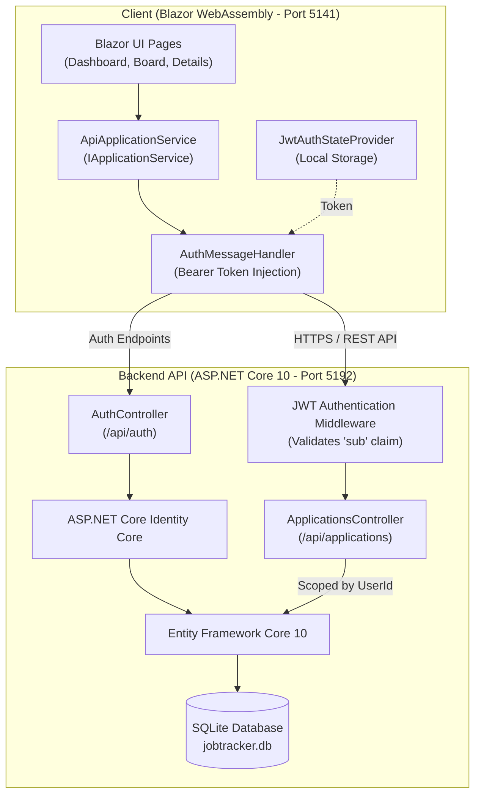

# 💼 JobTracker

> A modern, full-stack job application tracker built with **ASP.NET Core 10** and **Blazor WebAssembly**. Replace chaotic spreadsheets with an intuitive Kanban workflow, insightful analytics, and secure multi-tenant tracking.

[](https://dotnet.microsoft.com/)
[](https://dotnet.microsoft.com/apps/aspnet/web-apps/blazor)
[](https://dotnet.microsoft.com/apps/aspnet)
[](https://learn.microsoft.com/ef/core/)
[](https://www.sqlite.org/)
[](https://jwt.io/)
[](LICENSE)

---

## 📑 Table of Contents

- [Overview](#-overview)
- [Key Features](#-key-features)
- [System Architecture](#-system-architecture)
- [Tech Stack](#-tech-stack)
- [Project Structure](#-project-structure)
- [Getting Started](#-getting-started)
  - [Prerequisites](#prerequisites)
  - [Step 1: Clone the Repository](#step-1-clone-the-repository)
  - [Step 2: Configure JWT User Secrets](#step-2-configure-jwt-user-secrets)
  - [Step 3: Database Migration](#step-3-database-migration)
  - [Step 4: Run the Services](#step-4-run-the-services)
- [API Reference](#-api-reference)
- [Security & Architecture Highlights](#-security--architecture-highlights)
- [Roadmap](#-roadmap)
- [License](#-license)

---

## 🌟 Overview

Searching for a job often involves juggling dozens of applications, deadlines, recruiter messages, and follow-ups across different platforms. **JobTracker** provides a centralized, streamlined dashboard that helps job seekers stay organized and proactive throughout their job hunt.

Built as a single-page application (SPA) with **Blazor WebAssembly** backed by an **ASP.NET Core RESTful API**, JobTracker offers a responsive, desktop-class experience with real-time feedback, overdue follow-up warnings, and metrics to monitor application conversion rates.

---

## ✨ Key Features

| Feature | Description |
| :--- | :--- |
| 📋 **Interactive Kanban Board** | Visualize applications across five distinct stages: `Wishlist`, `Applied`, `Interview`, `Offer`, and `Rejected`. Fast status updates with card counters. |
| 📊 **Real-time Analytics Dashboard** | High-level overview displaying total applications, submitted roles, interviews scheduled, and conversion/response rates, accompanied by status distribution bars. |
| 🔍 **Live Search & Dynamic Filtering** | Instant client-side search across company name, role/position, location, and notes, combined with status dropdown filtering and dynamic result counts. |
| ⏰ **Overdue Follow-up Alerts** | Never miss a crucial touchpoint. Applications with passed follow-up dates are prominently highlighted with visual badges. |
| 🔐 **Secure Multi-User Auth** | Complete user registration and login powered by **ASP.NET Core Identity** and **JWT Bearer tokens** with complete per-user data segregation. |
| 🛡️ **Resilient User Experience** | Loading states with animated spinners, empty state illustrations, user-friendly error banners with one-click **Retry**, and deletion confirmation dialogs. |

---

## 🏗️ System Architecture

JobTracker adheres to a clean separation between client-side presentation and backend API services:



---

## 🛠️ Tech Stack

### Frontend (`JobTracker.Web`)
- **Framework:** [Blazor WebAssembly (.NET 10)](https://dotnet.microsoft.com/apps/aspnet/web-apps/blazor)
- **Styling & Layout:** Bootstrap 5, Bootstrap Icons
- **Auth Provider:** Custom `AuthenticationStateProvider` (`JwtAuthStateProvider`) using Browser `localStorage`
- **HTTP Pipeline:** `DelegatingHandler` (`AuthMessageHandler`) for automatic JWT attachment

### Backend (`JobTracker.Api`)
- **Framework:** [ASP.NET Core Web API (.NET 10)](https://dotnet.microsoft.com/apps/aspnet)
- **Authentication:** `Microsoft.AspNetCore.Authentication.JwtBearer`
- **Identity Membership:** `Microsoft.AspNetCore.Identity.EntityFrameworkCore`
- **ORM:** Entity Framework Core 10 (`Microsoft.EntityFrameworkCore.Sqlite`)
- **API Documentation:** Built-in OpenAPI specification support (`Microsoft.AspNetCore.OpenApi`)

### Database & Storage
- **Local Database:** SQLite 3 (`jobtracker.db`)
- **Migration Engine:** EF Core Migrations

---

## 📂 Project Structure

```text
JobTracker/
├── JobTracker.slnx                   # Solution configuration
├── README.md                         # Project documentation
└── src/
    ├── JobTracker.Api/               # ASP.NET Core REST API
    │   ├── Controllers/
    │   │   ├── ApplicationController.cs # CRUD operations for job applications
    │   │   └── AuthController.cs        # User registration and JWT login
    │   ├── Data/
    │   │   └── AppDbContext.cs          # EF Core DbContext with Identity
    │   ├── Dtos/
    │   │   └── AuthDtos.cs              # Register, Login & Token DTOs
    │   ├── Migrations/                  # EF Core database migrations
    │   ├── Models/
    │   │   ├── ApplicationStatus.cs     # Status enum (Wishlist -> Rejected)
    │   │   ├── ApplicationUser.cs       # Custom IdentityUser entity
    │   │   └── JobApplication.cs        # Application entity model
    │   ├── Services/
    │   │   └── TokenService.cs          # JWT token generation
    │   ├── appsettings.json             # API runtime configuration
    │   └── Program.cs                   # API dependency injection & middleware
    │
    └── JobTracker.Web/               # Blazor WebAssembly Client
        ├── Components/
        │   ├── ApplicationCard.razor    # Kanban item card with quick status moves
        │   ├── ApplicationForm.razor    # Reusable Add/Edit form component
        │   ├── LoadingSpinner.razor     # Reusable loading state component
        │   ├── RedirectToLogin.razor    # Unauthorized route redirector
        │   ├── StatsCard.razor          # Dashboard summary tile
        │   └── StatusColumn.razor       # Kanban board column container
        ├── Layout/
        │   ├── MainLayout.razor         # App layout with responsive navigation
        │   └── NavMenu.razor            # Sidebar navigation links
        ├── Pages/
        │   ├── ApplicationDetail.razor  # Add & Edit application views
        │   ├── Board.razor              # Interactive Kanban board
        │   ├── Dashboard.razor          # Analytics and follow-up view
        │   ├── Login.razor              # User login form
        │   └── Register.razor           # User registration form
        ├── Services/
        │   ├── AuthMessageHandler.cs    # Injects Bearer token into outgoing requests
        │   ├── AuthService.cs           # Authentication service helper
        │   ├── IApplicationService.cs   # Data service interface abstraction
        │   ├── ApiApplicationService.cs # API-backed implementation
        │   └── JwtAuthStateProvider.cs  # Manages browser auth state
        └── Program.cs                   # Blazor WASM client setup & DI
```

---

## 🚀 Getting Started

### Prerequisites

Ensure you have the following installed on your development workstation:
- [.NET 10 SDK](https://dotnet.microsoft.com/download/dotnet/10.0) or later
- [Git](https://git-scm.com/)
- EF Core CLI tool (install globally if not already installed):
  ```bash
  dotnet tool install --global dotnet-ef
  ```

---

### Step 1: Clone the Repository

```bash
git clone https://github.com/simply-shanta-4/JobTracker.git
cd JobTracker
```

---

### Step 2: Configure JWT User Secrets

To keep security keys out of source control, store your signing key in .NET User Secrets:

```bash
# Initialize and set JWT secret key for the API project
dotnet user-secrets init --project src/JobTracker.Api
dotnet user-secrets set "Jwt:Key" "YourSuperSecretKeyMustBeAtLeast32CharactersLong!" --project src/JobTracker.Api
```

---

### Step 3: Database Migration

Initialize the SQLite database schema using Entity Framework Core:

```bash
dotnet ef database update --project src/JobTracker.Api
```

> **Note:** This creates `jobtracker.db` in the `src/JobTracker.Api` directory.

---

### Step 4: Run the Services

You can run both projects simultaneously in separate terminals:

#### Terminal 1 — Start the API Server:
```bash
dotnet run --project src/JobTracker.Api
```
* The API will start on: **`http://localhost:5192`** (and `https://localhost:7255`)
* OpenAPI schema is available at: `http://localhost:5192/openapi/v1.json`

#### Terminal 2 — Start the Blazor WebAssembly Client:
```bash
dotnet run --project src/JobTracker.Web
```
* The web application will launch at: **`http://localhost:5141`** (and `https://localhost:7275`)

Navigate to `http://localhost:5141`, create an account on the **Register** page, and start organizing your applications!

---

## 📡 API Reference

All application endpoints require a valid JWT Bearer token supplied in the `Authorization: Bearer <token>` header.

### Authentication Endpoints

| Method | Endpoint | Description | Auth Required |
| :--- | :--- | :--- | :--- |
| `POST` | `/api/auth/register` | Register a new user account | No |
| `POST` | `/api/auth/login` | Authenticate and obtain a JWT bearer token | No |

#### Example Login Request:
```json
POST /api/auth/login
Content-Type: application/json

{
  "email": "user@example.com",
  "password": "Password123!"
}
```

#### Example Auth Response:
```json
{
  "token": "eyJhbGciOiJIUzI1NiIsInR5cCI6IkpXVCJ9...",
  "email": "user@example.com",
  "expiresAt": "2026-10-18T12:00:00Z"
}
```

---

### Application Endpoints

| Method | Endpoint | Description | Auth Required |
| :--- | :--- | :--- | :--- |
| `GET` | `/api/applications` | Retrieve all job applications for the logged-in user | Yes |
| `GET` | `/api/applications/{id}` | Retrieve a specific application by ID | Yes |
| `POST` | `/api/applications` | Create a new job application | Yes |
| `PUT` | `/api/applications/{id}` | Update an existing job application | Yes |
| `DELETE` | `/api/applications/{id}` | Delete an application | Yes |

#### Example Application Payload:
```json
{
  "company": "Acme Corp",
  "position": "Senior .NET Developer",
  "location": "Remote",
  "jobUrl": "https://example.com/jobs/dotnet-dev",
  "status": "Applied",
  "appliedOn": "2026-10-15T00:00:00",
  "followUpOn": "2026-10-22T00:00:00",
  "notes": "Spoke with recruiter; technical screen scheduled for next Tuesday."
}
```

---

## 🔒 Security & Architecture Highlights

- **Strict Multi-Tenant Isolation:** The backend reads the authenticated user's ID directly from the validated JWT token (`sub` claim) inside `ApplicationsController`. Every query is scoped by `UserId`, preventing users from reading, editing, or deleting another user's records.
- **Client-Side Authorization Bridge:** Uses `AuthenticationStateProvider` with `CascadingAuthenticationState` to protect client routes (`[Authorize]`) and conditionally render UI components.
- **Interface Segregation for Easy Testing:** The Blazor frontend interacts solely with the `IApplicationService` interface. Swapping between an in-memory mock service and `ApiApplicationService` requires changing just a single line in `Program.cs`.
- **Zero Hardcoded Secrets:** JWT symmetric keys are kept out of source code and loaded from .NET User Secrets in development and environment variables in production.

---

## 🗺️ Roadmap

- [ ] **Cloud Deployment:** Deploy to Microsoft Azure (Azure Static Web Apps for Blazor, Azure App Service & Azure SQL for backend).
- [ ] **Automated Reminders:** Background notifications for upcoming follow-up dates via Azure Functions or SendGrid.
- [ ] **CI/CD Pipeline:** Automated build, test, and release workflows with GitHub Actions.
- [ ] **Automated Testing:** Comprehensive unit and integration test coverage with xUnit, FluentAssertions, and bUnit.
- [ ] **Document Attachments:** Ability to store resumes and cover letter versions tied to specific applications.

---

## 📄 License

This project is licensed under the [MIT License](LICENSE).
